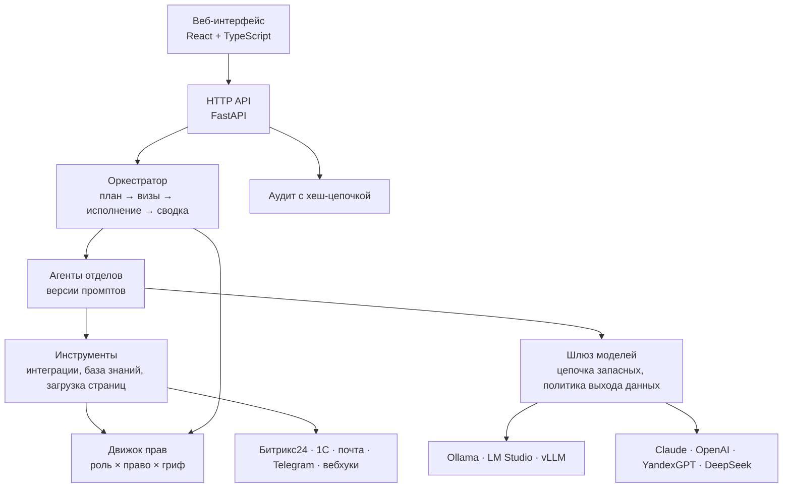

# Оркестр — платформа ИИ-агентов для компании

Платформа, которая встраивает ИИ в работу компании как команду сотрудников: у каждого отдела свои агенты, оркестратор раскладывает запрос на план и раздаёт шаги, единый шлюз выбирает модель — локальную или облачную, а строгие правила решают, кто что может. Агент никогда не получает больше прав, чем человек, от имени которого работает, и ничего не записывает во внешние системы без подтверждения.

Модульный монолит на FastAPI и React; работает на сервере компании за HTTPS или в окне на одном компьютере. 138 автотестов, CI с проверкой безопасности.

## Возможности

- **Оркестрация.** Запрос → план по агентам с зависимостями → параллельное исполнение → сводка. Ход работы виден в браузере вживую.
- **Любые модели.** Ollama и LM Studio на компьютере, vLLM на своём сервере, Claude, OpenAI, YandexGPT, DeepSeek, Siberi — через один шлюз с цепочкой запасных моделей.
- **Агенты и промпты.** Оргсхема по отделам, версии промптов с историей, публикация через визу, импорт и экспорт в `.md`. Песочница: прогнать черновик на примере и сравнить с работающей версией до публикации.
- **База знаний.** Регламенты, СП и ГОСТ, шаблоны (Word, PDF, текст). Поиск понимает формы слов и номера нормативов; агенты получают справку до ответа и ссылаются на документ — только в пределах прав человека и грифа задачи.
- **Процесс «Протоколы».** Протокол совещания (текст, Word, PDF) → задачи с ответственными, сроками и цитатами → проверка человеком → Битрикс24.
- **Интеграции.** Битрикс24, 1С (OData), почта, Telegram, входящие и исходящие вебхуки; демо-режим без настоящей системы. Действия систем становятся инструментами агентов.
- **Доступы.** Роли в подразделениях с наследованием вниз, матрица «право × роль»: можно, с визой или запрещено. Ответ на вопрос «может ли этот человек это сделать — и почему».
- **Безопасность.** Гриф данных и политика выхода в облако, шифрование ключей с ротацией мастер-ключа, двухфакторный вход, журнал аудита с хеш-цепочкой, принцип четырёх глаз, дневные лимиты токенов.

## Где здесь ИИ-инженерия

| Задача | Как решено |
| --- | --- |
| Сложный запрос не решается одним вызовом модели | Агент-оркестратор строит план — граф шагов с зависимостями между агентами отделов. Независимые шаги идут параллельно, шаги с записью во внешние системы останавливаются на «воротах визы», в конце — сводка |
| Разные модели под разные данные | Единый шлюз провайдеров с цепочкой запасных моделей. Политика выхода: данные с грифом выше разрешённого не уходят в облако — только на локальные модели. Персональные данные маскируются перед отправкой |
| Агенту нужны действия, но нельзя дать ему больше прав, чем у человека | Реестр инструментов: вызов разбирается из ответа модели и проверяется тем же движком прав, что и действия человека. Чтение — сразу и в пределах грифа; запись — агент только предлагает, выполняет человек или по визе |
| Ответы должны опираться на документы компании | RAG на BM25 с русским стеммингом и разбором номеров нормативов. Права и гриф применяются до выдачи фрагментов модели, ответ ссылается на документ |
| Промпт — это код, который ломает прод | Версии промптов с историей, песочница со сравнением против работающей версии, публикация через визу, манифест агента в `.md` с YAML-заголовком |
| Модель уверенно выдумывает исполнителя и срок | В «Протоколах» модель только понимает текст, а факты (люди, даты, цитаты) проверяют правила по справочнику. Неподтверждённое помечается и блокирует отправку в Битрикс24 до проверки человеком |
| Агент ходит в интернет | Инструмент загрузки страниц работает по белому списку доменов, с защитой от SSRF |
| Стоимость | Дневные лимиты токенов на каждого провайдера и на человека, расход виден по провайдерам |

## Архитектура



```
server/orchestra/    FastAPI, модульный монолит
  core/              хранилище секретов (AES-GCM + DPAPI), пароли (Argon2id), маскирование, события
  iam/               люди, оргструктура, роли, движок решений, сессии
  approvals/         визы: четыре глаза, визирующие роли, обработчики по типу
  audit/             журнал с хеш-цепочкой
  providers/         шлюз моделей: Ollama, OpenAI-совместимые, Claude, Siberi; политика выхода данных
  agents/            агенты, версии промптов, манифесты .md
  knowledge/         база знаний: разбор файлов, BM25 с русским стеммингом, поиск с правами и грифом
  integrations/      коннекторы (Битрикс24, 1С, почта, Telegram, вебхуки), предложения записей, визы
  processes/         готовые процессы: protocols/ — протокол → задачи → Битрикс24
  tools/             инструменты агентов (реестр + плагины)
  orchestration/     план, ворота виз, исполнение графа шагов, сводка
  api/               HTTP API
web/                 React + TypeScript, собственная дизайн-система
launcher/            окно приложения (pywebview) + сервер на 127.0.0.1
agents/              определения агентов (пример: проектная организация)
deploy/              Docker: PostgreSQL + приложение + Caddy
docs/                архитектура, безопасность, дорожная карта
```

Подробно: [docs/ARCHITECTURE.md](docs/ARCHITECTURE.md) · [docs/SECURITY.md](docs/SECURITY.md) · [docs/ROADMAP.md](docs/ROADMAP.md).

## Стек

**ИИ:** Anthropic SDK, OpenAI-совместимые API, Ollama, LM Studio, vLLM; оркестрация агентов, tool calling, RAG (BM25 + Snowball), версионирование промптов.
**Бэкенд:** Python 3.13, FastAPI, SQLAlchemy 2 (async), Alembic, Pydantic, SQLite или PostgreSQL, Argon2id, AES-GCM, TOTP.
**Фронтенд:** React, TypeScript, Vite.
**Инфраструктура:** Docker Compose, Caddy (TLS), pywebview для десктопа, GitHub Actions (pytest, bandit, pip-audit, npm audit, Dependabot).

Объём: около 9 600 строк Python, 3 900 строк TypeScript и 1 300 строк тестов.

## Быстрый старт (Windows, PowerShell 7)

```powershell
.\start.ps1              # окружение, зависимости, сборка интерфейса, сервер на http://127.0.0.1:8710
.\start.ps1 -Desktop     # то же в окне приложения (дальше — двойной клик по Orchestra.vbs)
.\start.ps1 -Dev         # сервер + Vite с горячей перезагрузкой на http://127.0.0.1:5173
```

При первом запуске сервер печатает разовый токен настройки (окно приложения подставляет его само) — создаётся владелец платформы. Дальше: **Модели → Подключить** (проще начать с локальной Ollama), **Доступы → Люди** — завести сотрудников.

Сервер компании (PostgreSQL + HTTPS): [deploy/README.md](deploy/README.md).

## Проверка

```powershell
cd server; .\.venv\Scripts\python -m pytest -q      # движок прав, криптография, планировщик, сквозные сценарии API
cd web; npm run typecheck; npm run build
```
