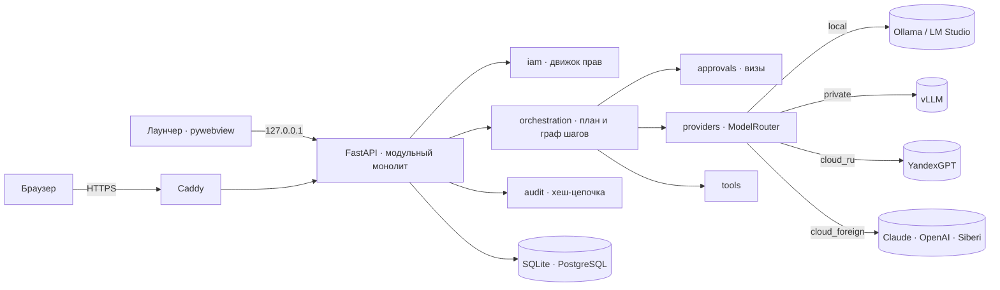
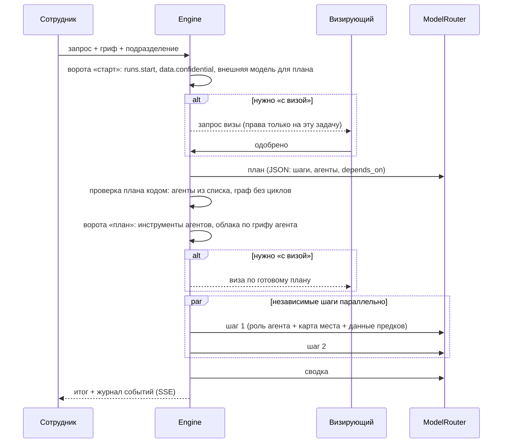
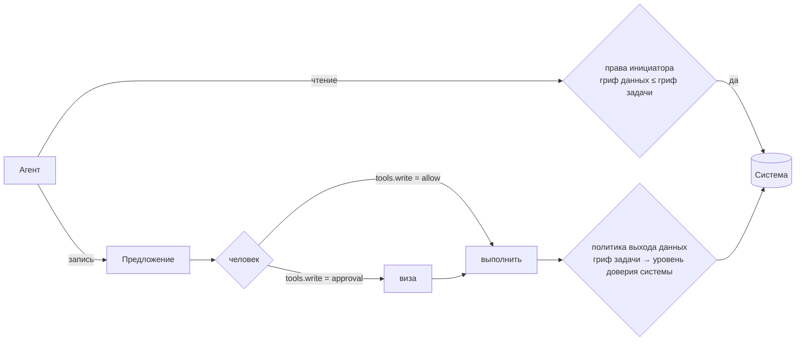

# Архитектура

## Принципы

1. **Безопасно по умолчанию.** Чего не выдали — нельзя. Конфиденциальное не уходит в облако. Необратимое — по визе.
2. **Агент действует от имени человека.** Права шага = права инициатора задачи (∩ инструменты агента). Никакой эскалации через агентов.
3. **Расширение без правок ядра.** Новая модель, инструмент, тип визы, агент — новый модуль или файл, а не правка движка.
4. **Определения — в git, операции — в БД.** Агенты (`agents/*.md`) и каталог прав версионируются; задачи, визы, аудит — рабочие данные.
5. **Сбой не маскируется.** Каждый отказ — с человеческой причиной: какой гриф, какое право, какая модель.

## Схема

**Почему модульный монолит, а не микросервисы.** Права, визы и аудит должны быть согласованы транзакционно;
команда — один человек; развёртывание — один контейнер на сервере компании. Границы модулей проведены так,
что вынести исполнителя задач в отдельные воркеры — замена реализации `Engine` и `EventBus`, а не переписывание.

## Модули

| Модуль | Отвечает за | Публичный интерфейс |
|---|---|---|
| `core` | секреты, пароли, токены, маскирование, шина событий, лимиты, защита от SSRF | `get_vault()`, `hash_password()`, `bus`, `netguard` |
| `iam` | люди, оргструктура, роли (в т. ч. временные), гранты, сессии, запросы доступа, защита от эскалации | `load_access(db, user) → AccessContext.decide(perm, unit)`, `guard.manageable()`, `deps.sudo(perm)` |
| `security` | тревоги безопасности и их канал | `alerts.raise_alert(kind, text, ip=…)` |
| `approvals` | визы, четыре глаза, обработчики | `request()`, `decide()`, `@on(kind)` |
| `audit` | журнал с хеш-цепочкой | `record()`, `defer()`, `verify()` |
| `providers` | шлюз моделей, политика выхода данных, учёт вызовов | `complete(db, CallContext, chain, ChatRequest)` |
| `agents` | агенты, версии промтов, манифесты, песочница | `seed_agents()`, `activate()`, `POST /api/agents/{id}/try` |
| `knowledge` | документы, разбор файлов, BM25, инструмент агентов | `service.search(db, access, query, max_class)` |
| `integrations` | коннекторы, вызовы, предложения записей, визы, входящие вебхуки | `execute()`, `propose()`, `submit()`, `@on_done(origin)` |
| `processes.protocols` | протокол → задачи → проверка → Битрикс24; справочник | `engine.start(protocol_id)`, `recheck()` |
| `tools` | инструменты агентов | `Tool`, `register()`, entry point `orchestra.tools` |
| `orchestration` | план, ворота, граф шагов, сводка | `engine.start(run_id)` |
| `system` | настройки платформы | `settings_store.get/put` |
| `api` | HTTP: схемы с `extra=forbid`, проверка прав, аудит | роутеры `/api/*` |

## Поток задачи

- Права «с визой», выданные визирующим, записываются в `run.preapproved` и действуют **только на эту задачу**.
- Гриф шага = максимум(гриф задачи, гриф агента): «Аналитик ТЗ» с грифом «конфиденциально» не уйдёт в облако, даже если задача «для служебного».
- Невозможное отсекается до вызова модели: нет допустимой модели — задача останавливается с причиной, ни один шаг не стартует.
- Сбой шага → повтор; не вышло → зависимые шаги пропускаются, независимые доделываются, сводка говорит, что не выполнено.
- Перезапуск сервера → прерванные задачи помечаются «прервано» честно и повторяются одной кнопкой.
- У агента с базой знаний справка подкладывается в поручение **до** вызова модели: локальные модели не всегда сами
  решают поискать и тогда выдумывают сроки. Модель может искать и сама — тем же инструментом.

## База знаний

- Документ принадлежит подразделению; читают его сотрудники подразделения, вложенных и **вышестоящих** —
  регламент компании (корень) видят все, документы соседнего отдела — нет. Гриф «конфиденциально» и выше
  читает только тот, у кого `data.confidential`.
- Агент получает фрагменты только с грифом **не выше грифа шага**: иначе конфиденциальный документ ушёл бы
  через поиск в облачную модель, допущенную лишь до «для служебного».
- Поиск — BM25 в памяти с русским и английским стеммингом; номера нормативов («21.101») — целыми токенами;
  у длинных слов второй ключ — начало слова (Snowball режет «надпись» и «надписи» по-разному). Индекс
  пересобирается при изменении набора документов. На росте — PostgreSQL FTS / pgvector за тем же `search()`.
- Файлы — недоверенный ввод: до 15 МБ, проверка распаковки .docx (zip-бомба), до 800 страниц PDF, разбор
  в отдельном потоке с таймаутом.

## Интеграции

Коннектор (`integrations/base.py`) описывает себя: поля настройки (форма в интерфейсе строится по ним),
секрет, действия с пометкой «чтение» или «запись», демо-режим. Каждое действие включённой интеграции
автоматически становится инструментом агентов: `bitrix.create_task`, `onec.find_counterparty`, `mail.send`.

- **Чтение** выполняется сразу, но данные 1С («конфиденциально») не попадут в задачу «для служебного» — иначе
  ушли бы в облачную модель. Нужен гриф задачи не ниже грифа системы — тогда и модели только локальные.
- **Запись** агент не выполняет никогда: `IntegrationAction` в статусе «предложено» видна на странице задачи;
  человек выполняет кнопкой или отправляет на визу. Визы на план для записей не нужны — визируется каждое действие.
- **Входящий вебхук** (`/api/hooks/{id}`) ставит задачу агентам от имени того, кто его настроил; подпись HMAC-SHA256
  или токен (исходящий вебхук Битрикс24), лимит частоты, событие передаётся модели как данные.
- Новая система — класс `Connector` в `integrations/connectors/` (или entry point `orchestra.integrations`); интерфейс,
  права, аудит, инструменты агентов появляются сами.

## Процессы

Процесс — готовый сценарий из агентов, правил, проверки человеком и интеграций, когда общей оркестрации мало.
Первый — **«Протоколы»**: правила (справочник, сроки, цитаты, отпечаток подтверждения)
перенесены вместе с тестами; модель — через шлюз платформы с промптом агента «Разборщик протоколов» (служебная роль:
оркестратор его в план не берёт, а версии промпта и песочница — общие); справочник — из БД и Битрикс24;
отправка — действие интеграции с перепроверкой. Новый процесс — пакет в `processes/` + роутер + экран.

## Модель доступа

- **Каталог прав** — в коде (`iam/permissions.py`): 32 права в 11 группах, у каждого — подсказка, «бывает ли с визой», «рискованное».
- **Роль** выдаёт право с эффектом `allow` / `approval` (+ визирующая роль) / `deny`.
- **Назначение** = человек × подразделение × роль (бессрочно или до даты). Роль действует в подразделении и во всех вложенных.
- **Решение:** владелец → allow; любой `deny` → нельзя; любой `allow` → можно; любой `approval` → с визой; иначе нельзя.
- **Визы:** решает тот, у кого `approvals.decide` в подразделении запроса (и нужная роль, если указана). Свой запрос — никогда.
- **Против эскалации:** выдать роли право или назначить роль можно, только обладая всеми этими правами самому — в том же подразделении. Снять запрет = расширить. Управлять учётной записью — только если её управляющие и рискованные права есть у тебя. Свои роли — руками другого. Владельца меняет только владелец; последнего владельца снять нельзя.
- **Опасные действия** (права, роли, ключи, политика) — `Depends(sudo("perm"))`: право + пароль, введённый не дольше 10 минут назад. Интерфейс сам спрашивает пароль и повторяет запрос.
- **Запрос доступа:** сотрудник просит роль на срок → виза того, кто вправе её выдать (`approvals.can_decide(kind)` — доп. условие для своего типа визы).

## Шлюз моделей

Провайдер — класс `ChatProvider` (`chat`, `stream`, `list_models`). `ModelRouter.complete` для каждой модели цепочки:
включена → гриф допустим для уровня доверия → для облака у инициатора `providers.external` (или виза) →
маскирование ПДн → вызов с повтором на временных сбоях → следующая модель. Каждая попытка — строка `llm_calls`.

Протокол инструментов не зависит от провайдера: модель отвечает текстом или одним JSON `{"tool", "args"}`.
Так одинаково работают Claude, Ollama и Siberi (у последней нативных tool calls нет).

## Как расширять

| Что | Как |
|---|---|
| Модель/провайдер | класс `ChatProvider` в `providers/` + строка в `registry.KINDS` (или entry point `orchestra.providers` из отдельного пакета); пресет — в `PRESETS` |
| Инструмент | класс `Tool` со `spec.permission` (`tools.read/web/write`) + `register()` или entry point `orchestra.tools` |
| Право | строка в `CATALOG`; проверка `p.access.decide("...", unit_id)` в роутере — матрица в интерфейсе появится сама. Выдача системным ролям: в `iam/seed.py` (новые установки) **и** миграцией со снимком (существующие, пример — 0002). Опасное действие — `sudo("perm")` вместо `require("perm")`. Новый маршрут сам попадёт в тест-обход «без сессии → 401, без CSRF → 403» (`tests/test_hardening.py`) |
| Тип визы | `@approvals.on("kind")` — обработчик меняет данные в транзакции и возвращает действие после фиксации |
| Агент | `.md` в `agents/` (импорт при первом запуске) или кнопка «Агент» / «Импорт .md» |
| Таблица/поле | модель SQLAlchemy → `alembic revision --autogenerate` → миграция применяется при старте |

## Решения

| Решение | Почему | Что взамен, когда вырастем |
|---|---|---|
| Python + FastAPI | экосистема ИИ, прошлые проекты на Python (AI Vision), async | — |
| SQLite (лаунчер) / PostgreSQL (сервер) | ноль настройки на одном ПК; надёжность и триггеры на сервере | — |
| Шина событий в памяти | один процесс достаточно для 80 человек | Redis Pub/Sub за тем же интерфейсом |
| Исполнитель в процессе (asyncio) | простота, восстановление после перезапуска | очередь (arq/Redis) + воркеры — замена `Engine.start` |
| Текстовый протокол инструментов | работает с любой моделью | нативные tool calls для провайдеров, где они есть |
| Каталог прав в коде | типизирован, проходит ревью, без опечаток | — |
| Аудит отдельной транзакцией + `defer` | отказы пишутся даже при откате; SQLite не держит две записи | — |
| Метка конца журнала — файл с HMAC вне БД | обрезка хвоста и откат базы видны без внешнего сервиса | отправка меток во внешний журнал (syslog/SIEM) |
| Атомарные переходы статуса (`UPDATE … WHERE status=…`) | двойное нажатие и две визы не выполняют запись дважды ни на SQLite, ни на PostgreSQL | — |
| Сетевой слой httpx с проверкой адреса при подключении | один механизм против SSRF и DNS-rebinding для всех исходящих клиентов | — |
